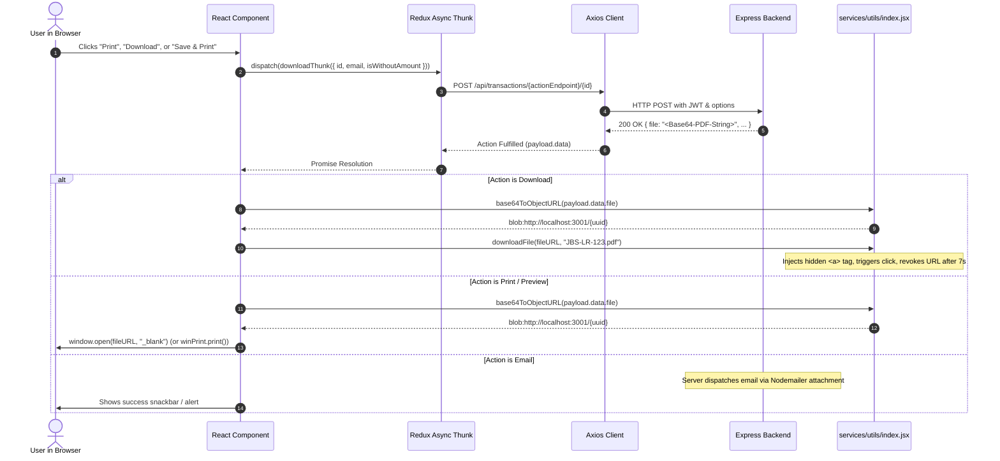
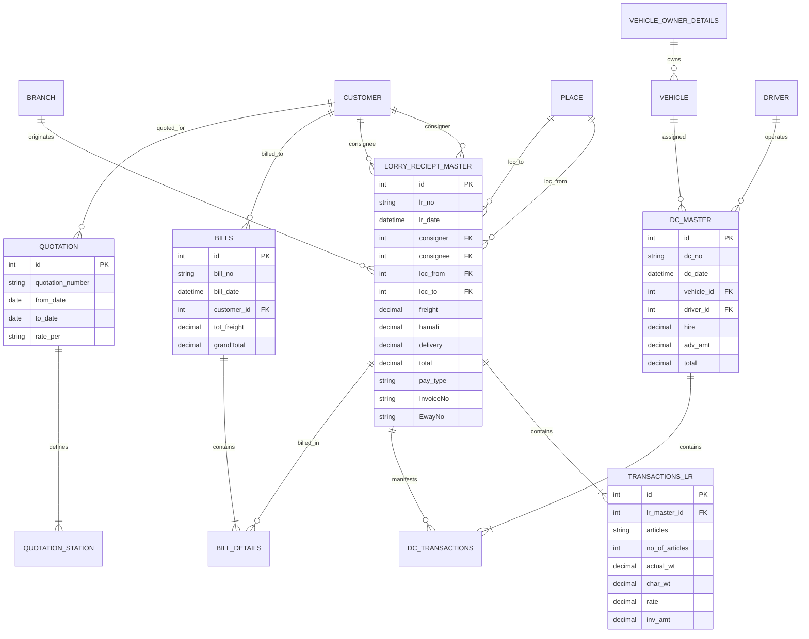
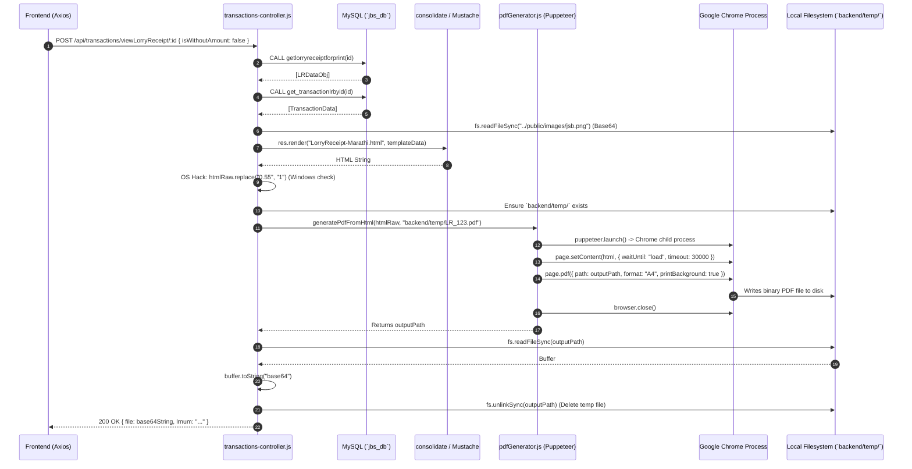
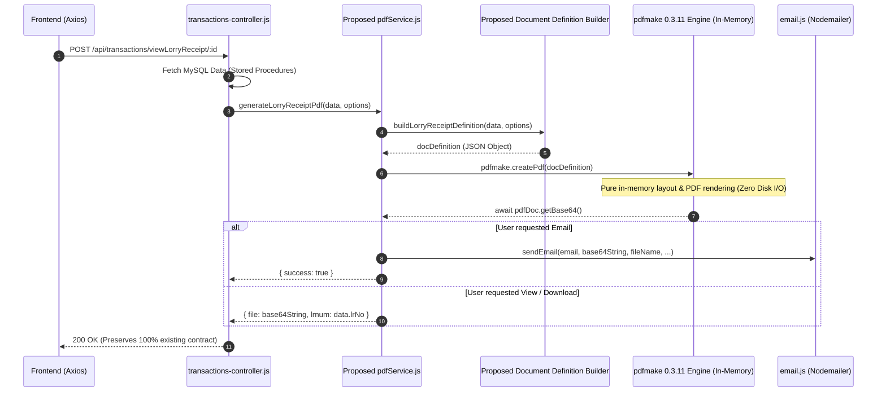
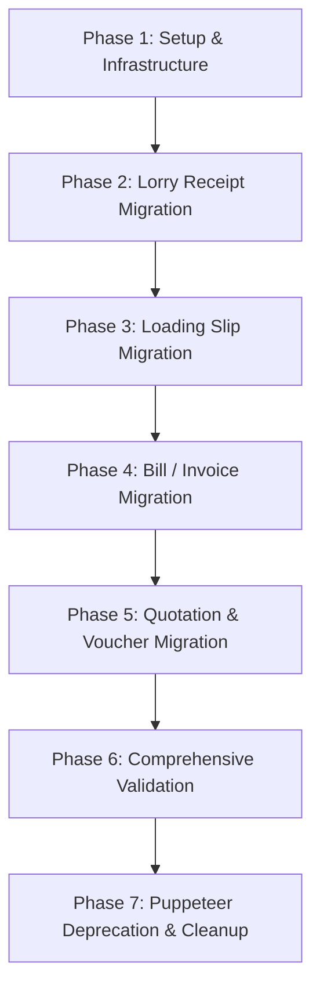

# JBS PROJECT — MASTER ARCHITECTURAL BLUEPRINT & PDF MIGRATION STRATEGY
## Transition from Puppeteer-Core to In-Memory pdfmake (`^0.3.11`)

---

## 1. Project Overview

### 1.1 Executive Summary
The **JBS Transport Management System** (repository: `JBS-Transport-main`) is an enterprise logistics and transport management application serving Indian freight operations. It manages Lorry Receipts (LR), Loading Slips / Challans (LTS / DC), Customer Billing & Invoices, Rate Masters, Quotations, and Payment Collections.

The application currently relies on **Puppeteer Core (`^25.5.0`)** invoking a local Google Chrome executable to render HTML/CSS templates via headless Chromium and print them to temporary PDF files on disk (`backend/temp/*.pdf`). The PDF files are then read synchronously from disk into Node.js buffers, encoded to Base64 strings, deleted from disk via `fs.unlinkSync()`, and returned to the frontend or emailed.

This blueprint documents the complete current system architecture and defines an evidence-based, zero-disk-write migration strategy to replace Puppeteer Core with **`pdfmake: "^0.3.11"`**.

### 1.2 Core Migration Objectives
1. **Eliminate Headless Browser Overhead:** Remove Puppeteer Core, Chromium process spawning, Chrome executable path dependencies, and OS-specific zoom hacks (`zoom: 0.55`, `zoom: 0.66`, `replace("0.55", "1")`).
2. **100% In-Memory Generation:** Ensure zero temporary file creation on disk, eliminating disk I/O bottlenecks and orphan file leaks in `backend/temp/`.
3. **Preserve Exact Existing Contracts:** Preserve the existing HTTP REST API contracts (`res.json({ file: base64String, ... })`), ensuring zero breaking changes to the React frontend preview, download, or email flows.
4. **Layout & Multi-Language Parity:** Maintain printable document layout fidelity, tabular alignment, checkbox states, and Unicode font rendering—specifically supporting Marathi / Devanagari script used in legal declarations on Lorry Receipts.

---

## 2. Audit Scope and Methodology

### 2.1 Scope of Codebase Audit
The audit covered 100% of the active repository at `c:\Users\giriv\OneDrive - Avotech systems pvt ltd\JBS-Transport-main`:
- **Frontend Codebase:** `frontend/` (Vite, React 18, Redux Toolkit, React Router v6, Material-UI v5 / `@mui/x-data-grid`).
- **Backend Codebase:** `backend/` (Node.js, Express 4.21, mysql2/promise, puppeteer-core 25.5, consolidate, nodemailer, exceljs).
- **Database Schema & Runtime:** Live local MySQL database (`jbs_db`), dump files (`dump_jbstrans_db_20260702094639.sql`, `JBS Full 10-jun-26.sql`), stored procedures, relational constraints, and schema tables.
- **Document Assets & Templates:** `backend/bills/` (7 HTML templates), `backend/public/images/` (branding, checkboxes, and logos).

### 2.2 Audit Methodology
1. **Static Analysis & AST Tracing:** Traced imports, exports, route registrations, controller functions, and Redux async thunks across both frontend and backend.
2. **Runtime Execution Verification:** Inspected active Node.js processes, verified MySQL connectivity via `mysql2/promise`, executed active stored procedures (`getallbranches`, `getlorryreceiptforprint`, `getbillprintbyid`, `getbilldetailsprintbyid`), and validated live response shapes.
3. **Template Decomposition:** Deconstructed CSS `@page` configurations, inline styles, table geometries, image bindings, and Mustache replacement tags across all existing HTML templates.
4. **Target Library Specification:** Researched authoritative breaking changes and APIs for `pdfmake: "^0.3.11"` (Promise-based asynchronous APIs, unified browser/server interface, `addVirtualFileSystem`, and `addFonts`).

---

## 3. Verified Technology Stack

| Layer | Component | Version / Specification | Verified Source |
| :--- | :--- | :--- | :--- |
| **Frontend Runtime** | React | `^18.2.0` | `frontend/package.json` |
| **Frontend Tooling** | Vite | `^4.4.9` | `frontend/package.json` |
| **Frontend State** | Redux Toolkit / Redux Persist | `^1.9.6` / `^6.0.0` | `frontend/package.json` |
| **Frontend UI** | Material UI (MUI v5) / Emotion | `@mui/material: ^5.14.11`, `@mui/x-data-grid: ^6.16.0` | `frontend/package.json` |
| **Frontend HTTP** | Axios | `^1.5.1` | `frontend/package.json` |
| **Backend Runtime** | Node.js | `v24.18.0` (Active Local Runtime) | Node environment inspection |
| **Backend Framework**| Express.js | `^4.21.0` | `backend/package.json` |
| **Database Driver** | MySQL2 (Promise Wrapper) | `^3.11.3` | `backend/package.json` |
| **Database Engine** | MySQL (InnoDB) | Database: `jbs_db` | `backend/database/db.js` |
| **Active PDF Engine** | Puppeteer Core | `^25.5.0` (invoking Google Chrome binary) | `backend/package.json`, `backend/utils/pdfGenerator.js` |
| **Target PDF Engine** | pdfmake | `^0.3.11` (**Proposed Target**) | Specification requirement |
| **Template Engine** | Consolidate / Mustache | `consolidate: ^0.16.0`, `mustache: ^4.2.0` | `backend/package.json`, `backend/index.js` |
| **Email Transport** | Nodemailer | `^6.9.5` | `backend/package.json`, `backend/controller/email.js` |
| **Spreadsheet Engine**| ExcelJS | `^4.3.0` | `backend/package.json` (Used for `.xlsx` reports) |

---

## 4. Actual Project Directory Structure

```
JBS-Transport-main/
├── blueprint.md                                  # [THIS DOCUMENT] Master Architectural Blueprint
├── dump_jbstrans_db_20260702094639.sql          # MySQL database dump backup
├── dump_utsavroa_db_20260703063149.sql          # Secondary database dump
├── JBS Full 10-jun-26.sql                       # Full MySQL database backup
│
├── frontend/                                     # React 18 SPA (Vite)
│   ├── index.html                               # HTML Entry point
│   ├── package.json                             # Frontend dependencies & scripts
│   ├── vite.config.js                           # Vite configuration
│   └── src/
│       ├── App.jsx                              # ThemeProvider, PersistGate, Layout wrap
│       ├── main.jsx                             # React DOM render
│       ├── assets/                              # Icons and SVG arrows
│       ├── components/                          # Layout, Header, Navigation, Footer
│       │   ├── header/Header.jsx                # App banner, SuperAdmin badge, hamburger
│       │   ├── layout/Layout.jsx                # Layout wrapper
│       │   └── navigation/Navigation.jsx        # Sidebar navigation drawer
│       ├── modules/                             # Domain feature modules
│       │   ├── home/Welcome.jsx                 # Home dashboard
│       │   ├── master/                          # Master data (Articles, Branches, Customers, Drivers, Places, Vehicles)
│       │   ├── reports/                         # Excel-based reporting modules
│       │   ├── user/                            # User authentication & permissions
│       │   └── transactions/                    # TRANSACTION FLOWS (PDF GENERATION CONSUMERS)
│       │       └── components/
│       │           ├── lorry-receipts/          # LR management (LorryReceipts, LorryReceiptAdd, LorryReceiptEdit)
│       │           ├── Client-lorry-receipts/   # Client-facing LR views
│       │           ├── loading-slips/           # Loading slip/challan (LoadingSlips, LoadingSlipAdd, LoadingSlipEdit)
│       │           ├── bills/                   # Billing & Freight Invoices (BillList, BillAdd, BillEdit)
│       │           ├── quotations/              # Quotations (QuotationList, QuotationAdd, QuotationEdit)
│       │           └── payment-collection/      # Payment collections & vouchers
│       ├── redux/                               # Root store & combined reducers
│       ├── router/                              # React Router v6 routing & RequireAuth guards
│       ├── services/
│       │   ├── api/index.jsx                    # Axios instance & interceptors
│       │   ├── constants/index.jsx              # API_BASE_PATH ('http://localhost:4800/')
│       │   └── utils/index.jsx                  # base64ToObjectURL(), downloadFile(), formatters
│       └── style/                               # Global index.css and responsive.css
│
└── backend/                                      # Express.js REST API
    ├── index.js                                 # Express app setup, CORS, static routes, server listen (Port 4800)
    ├── package.json                             # Dependencies (mysql2, puppeteer-core, nodemailer, etc.)
    ├── checkDuplicateLr.js                      # Maintenance scripts
    ├── createAdmins.js                          # Database seeding scripts
    ├── bills/                                   # HTML TEMPLATES FOR PDF GENERATION
    │   ├── Bill.html                            # Freight Invoice HTML template (Multi-page)
    │   ├── LoadingSlip.html                     # Lorry Receipt Challan HTML template (Multi-page)
    │   ├── LorryReceipt-Marathi.html            # Active LR template (Bilingual / Marathi, 2-up per A4)
    │   ├── LorryReceipt.html                    # English LR template (Legacy)
    │   ├── LorryReceipt-single.html             # Single-copy LR template (Unreferenced)
    │   ├── Quotation.html                       # Quotation Letterhead template
    │   └── Voucher.html                         # Payment Voucher template
    ├── controller/                              # Route handler controllers
    │   ├── email.js                             # Nodemailer transport for sending base64 PDF attachments
    │   ├── master-controller.js                 # CRUD for branches, places, customers, vehicles, etc.
    │   ├── openAI.js                            # AI translation helper
    │   ├── transactions-controller.js           # 9,860 lines: ALL PDF endpoints, MySQL stored procedure calls
    │   └── user-controller.js                   # Authentication & user permissions
    ├── database/
    │   └── db.js                                # mysql2/promise Connection Pool configuration
    ├── middleware/
    │   └── check-auth.js                        # JWT Bearer token authentication middleware
    ├── models/                                  # Legacy Mongoose schemas (inactive migration remnants)
    ├── public/
    │   └── images/                              # STATIC ASSETS EMBEDDED IN PDFS
    │       ├── checked.png                      # Checkbox checked state icon (PNG)
    │       ├── jsb.png                          # J.B.S. TRANSPUNE corporate logo (PNG)
    │       ├── laxmi.jpeg                       # Deity / header icon (JPEG)
    │       ├── logo.png                         # Secondary company logo (PNG)
    │       └── unchecked.png                    # Checkbox unchecked state icon (PNG)
    ├── routes/
    │   ├── master-routes.js                     # Master REST routes
    │   ├── transactions-routes.js               # Transaction REST routes (/viewLorryReceipt, /printBill, etc.)
    │   └── user-routes.js                       # User & auth routes
    ├── secrets/
    │   └── secrets.js                           # JWT secret key & email SMTP credentials
    ├── temp/                                    # TEMPORARY RUNTIME DISK DIRECTORY (PUPPETEER DISK SPILL)
    │   └── W-01279_1785416071415.pdf            # Leaked PDF file verified during audit
    └── utils/
        └── pdfGenerator.js                      # Puppeteer-core browser launch & page.pdf() wrapper
```

---

## 5. React Frontend Architecture & PDF Handling

### 5.1 Architecture & State Flow
The React frontend is a Single Page Application (SPA) built with Vite and React Router v6.
- All PDF-related user actions occur within `frontend/src/modules/transactions/`.
- Network requests are dispatched via Redux Async Thunks defined in feature slices (e.g., `lorryReceiptSlice.jsx`, `billSlice.jsx`, `loadingSlipSlice.jsx`, `quotationSlice.jsx`).
- API requests are executed through Axios (`services/api/index.jsx`), pointing to `API_BASE_PATH = 'http://localhost:4800/'`.
- Authentication tokens are attached automatically via request interceptors from Redux state:
  ```javascript
  config.headers.Authorization = `Bearer ${user.token}`;
  ```

### 5.2 Unified Frontend PDF Consumption Mechanism
Every PDF endpoint in the application communicates with the frontend using a single, unified contract:



### 5.3 Verified Client-Side Utility Implementations
In `frontend/src/services/utils/index.jsx`:
- **`base64ToObjectURL(base64)`** (Lines 217–232):
  Decodes Base64 to a binary byte array using `window.atob()`, instantiates a `Blob` of type `"application/pdf;base64"`, and calls `URL.createObjectURL(file)`.
- **`downloadFile(fileURL, fileName)`** (Lines 234–242):
  Creates a dynamic DOM `<a>` tag, sets `link.download = "JBS-" + fileName`, appends to `document.body`, triggers programmatic `.click()`, removes the tag, and revokes the URL after 7,000ms.

> **Crucial Migration Requirement:** Because the frontend relies strictly on receiving `{ file: base64String }`, returning an in-memory Base64 string from the backend preserves 100% of frontend compatibility with zero UI changes.

---

## 6. Node.js Backend Architecture

### 6.1 Application Structure & Middleware Pipeline
In `backend/index.js`:
- Express 4.21 initializes with `bodyParser.urlencoded({ extended: false })` and `bodyParser.json()`.
- Static directory mounts: `/public` (`backend/public`) and `/bills` (`backend/bills`).
- Template engine setup:
  ```javascript
  app.engine("html", engines.mustache);
  app.set("view engine", "html");
  ```
- CORS enabled globally with preflight options `app.options('*', cors())`.
- Route registration:
  - `/api/user` -> `backend/routes/user-routes.js`
  - `/api/master` -> `backend/routes/master-routes.js`
  - `/api/transactions` -> `backend/routes/transactions-routes.js`

### 6.2 Authentication Guard
In `backend/middleware/check-auth.js`:
- Extracts JWT from `req.headers.authorization.split(" ")[1]`.
- Verifies token against `secrets.authKey`.
- Attaches decoded `username`, `userId`, and `type` to `req.userData`.
- Upon failure, returns HTTP 200 `{ message: "Authentication failed. Please try after relogging or contact the administrator." }`.

---

## 7. MySQL Database Architecture

### 7.1 Database Access Layer
Configured in `backend/database/db.js`:
- Uses `mysql2/promise` with connection pooling:
  ```javascript
  const mysql = require('mysql2/promise');
  const pool = mysql.createPool({
      connectionLimit: 10,
      multipleStatements: true,
      user: 'root',
      password: 'password',
      database: 'jbs_db',
      host: 'localhost',
  });
  ```
- Database Definer Requirement: Stored procedures are defined with `DEFINER = 'jbstrans'@'localhost'`.

### 7.2 Tables & Relationships in PDF Generation



---

## 8. Existing API and Request/Response Flow

### Current PDF Generation Workflow (Puppeteer Core)



### Critical Bottlenecks in the Current Flow
1. **Cold-Start Latency:** Every single PDF generation spawns a full headless Google Chrome OS process (`chrome.exe`) taking 1,200ms–3,500ms per document.
2. **Heavy RAM Usage:** Headless Chrome consumes 150MB–350MB of RAM per instance. Concurrent requests risk memory exhaustion and crashes.
3. **Hard Disk Dependency:** The PDF is written to disk at `backend/temp/${fileName}_${Date.now()}.pdf`, read back synchronously, and unlinked.
4. **Orphan Leaks:** Any error between `generatePdfFromHtml` and `fs.unlinkSync` permanently leaks PDF files on the server (as verified by `backend/temp/W-01279_1785416071415.pdf`).
5. **Platform Inconsistency:** Chromium renders CSS zoom, fonts, and box models differently across Windows and Linux, necessitating brittle regex hacks like `htmlRaw.replace("0.55", "1")`.

---

## 9. Complete PDF Generation Inventory

| ID | Document Name | Purpose | Frontend Trigger | Backend Route & Method | Controller & Line | SQL Procedures / Queries | HTML Template | Embedded Assets | Target Page Config |
| :---: | :--- | :--- | :--- | :--- | :--- | :--- | :--- | :--- | :--- |
| **PDF-01** | **Lorry Receipt (Marathi/Bilingual)** | Official consignment receipt (Consignor & Driver copies) | `LorryReceipts.jsx`, `LorryReceiptAdd.jsx`, `LorryReceiptEdit.jsx`, `ClientLorryReceipts.jsx` | `POST /api/transactions/viewLorryReceipt/:id` | `transactions-controller.js` (L.2336) | `CALL getlorryreceiptforprint(?)`, `CALL get_transactionlrbyid(?)` | `backend/bills/LorryReceipt-Marathi.html` | `jsb.png`, `checked.png`, `unchecked.png` | A4 Portrait, 2 copies stacked on 1 page with dashed separator |
| **PDF-02** | **Loading Slip / Challan** | Vehicle dispatch, trip hire, advance & driver manifest | `LoadingSlips.jsx`, `LoadingSlipAdd.jsx`, `LoadingSlipEdit.jsx` | `POST /api/transactions/printLoadingSlip/:id` | `transactions-controller.js` (L.4582) | Complex JOIN on `dc_master`, `vehicle`, `driver`, `place`, `branch`, + LR manifest query | `backend/bills/LoadingSlip.html` | `jsb.png`, `checked.png` | A4 Portrait, multi-page (20 LRs/page), repeated header, terminal summary block |
| **PDF-03** | **Freight Invoice / Bill** | Tax invoice billed to customer with breakdown | `BillList.jsx`, `BillAdd.jsx`, `BillEdit.jsx` | `POST /api/transactions/printBill/:id` | `transactions-controller.js` (L.6432) | `CALL getbillprintbyid(?)`, `CALL getbilldetailsprintbyid(?)` | `backend/bills/Bill.html` | `jsb.png`, `checked.png` | A4 Portrait, multi-page (20 rows/page), 13 tabular columns, GST & bank details |
| **PDF-04** | **Quotation** | Transport rate proposal submitted to prospective clients | `QuotationList.jsx` | `POST /api/transactions/viewQuotation/:id` | `transactions-controller.js` (L.7624) | `SELECT FROM quotation WHERE id=?`, `SELECT FROM quotation_station WHERE quotation_id=?` | `backend/bills/Quotation.html` | `jsb.png` | A4 Portrait, formal letterhead layout, dynamic destination columns, terms list |
| **PDF-05** | **Payment Collection Voucher** | Receipt for received payments against customer bills | `PaymentCollectionHistory.jsx` | `POST /api/transactions/viewPaymentCollection/:billId/:collectionId` | `transactions-controller.js` (L.7776) | *Legacy Mongoose* `Bill.findById`, `Customer.findById` (**Requires Verification**) | `backend/bills/Voucher.html` | `logo.png`, `laxmi.jpeg` | A4 Portrait, receipt voucher format, payment mode & cheque details |
| **PDF-06** | **Lorry Receipt (English)** | Legacy single-page English LR format | *Unreferenced in active UI* (Subsumed by Marathi bilingual LR) | Internal helper `generateLrPdf` (L.1815) | `transactions-controller.js` (L.1815) | Passed in-memory object from legacy `createLorryReceipt` | `backend/bills/LorryReceipt.html` | `jsb.png` | A4 Portrait, single/stacked legacy format |

---

## 10. Existing Puppeteer Core Implementation

### 10.1 Implementation Details
Located in `backend/utils/pdfGenerator.js`:
```javascript
const puppeteer = require("puppeteer-core");

const CHROME_PATH =
  process.env.PUPPETEER_EXECUTABLE_PATH ||
  "C:\\Program Files\\Google\\Chrome\\Application\\chrome.exe";

const generatePdfFromHtml = async (html, outputPath, pdfOptions = {}) => {
  let browser;
  try {
    browser = await puppeteer.launch({
      headless: "new",
      executablePath: CHROME_PATH,
      args: ["--no-sandbox", "--disable-setuid-sandbox"],
    });
    const page = await browser.newPage();
    await page.setContent(html, { waitUntil: "load", timeout: 30000 });
    await page.pdf({
      path: outputPath,
      format: "A4",
      printBackground: true,
      margin: { top: "10mm", right: "10mm", bottom: "10mm", left: "10mm" },
      ...pdfOptions,
    });
    return outputPath;
  } catch (err) {
    console.error("PDF generation failed:", err.message);
    throw err;
  } finally {
    if (browser) await browser.close();
  }
};
```

### 10.2 Architectural Flaws Identified
1. **Environment Fragility:** If `PUPPETEER_EXECUTABLE_PATH` is unset on Linux or Windows servers where Google Chrome is not installed at the default path, the entire PDF capability crashes immediately.
2. **No Resource Sharing:** A new browser instance is launched and torn down for *every* print request. No pooled browser or shared contexts exist.
3. **Double Encoding:** HTML is converted to PDF on disk, read into a Node.js binary Buffer, then converted into an ASCII Base64 string (`buffer.toString("base64")`).

---

## 11. Current PDF Storage and Delivery Behavior

### 11.1 Disk Storage Audit
- **Temporary Path:** PDFs are written to `backend/temp/${fileName}_${Date.now()}.pdf`.
- **Cleanup Logic:** In all 5 active endpoints, cleanup is performed via:
  ```javascript
  const buffer = fs.readFileSync(outputPath);
  const base64String = buffer.toString("base64");
  fs.unlinkSync(outputPath);
  ```
- **Audit Finding:** The cleanup is synchronous and placed outside `finally` blocks. If `fs.readFileSync` or preceding code throws, `fs.unlinkSync` never executes, leaving files stranded on disk.

### 11.2 Delivery Contract
- **Response Format:** `application/json`
- **Response Body:**
  ```json
  {
    "file": "JVBERi0xLjQKJcOkw7zDtsOfCDC...",
    "lrnum": "W-01234"
  }
  ```
- **Email Delivery:** If `req.body.email` is provided, `backend/controller/email.js` sends the Base64 string as an attachment via Nodemailer:
  ```javascript
  attachments: [{ filename: `${fileName}.pdf`, content: base64String, encoding: "base64" }]
  ```

---

## 12. Target pdfmake `^0.3.11` Architecture

### 12.1 Proposed Target Workflow



### 12.2 pdfmake `^0.3.11` API Specifics & Breaking Changes
`pdfmake` version `0.3.11` introduces fundamental changes from legacy `0.1.x/0.2.x`:
1. **Asynchronous Promise API:** Document generation methods no longer accept callbacks. `getBuffer()`, `getBase64()`, and `getBlob()` return Promises.
   ```javascript
   // Verified 0.3.11 API pattern:
   const pdfDoc = pdfMake.createPdf(docDefinition);
   const base64String = await pdfDoc.getBase64();
   ```
2. **Font & VFS Registration:** Fonts and Virtual File System assets must be registered upfront on the pdfmake instance rather than passed into `createPdf`:
   ```javascript
   pdfMake.addVirtualFileSystem(vfs);
   pdfMake.addFonts(fonts);
   ```
3. **Server-Side Compatibility:** Fully supported on Node.js `>=20 LTS` (current environment: `v24.18.0`).

---

## 13. Disk-Free In-Memory PDF Generation Strategy

### 13.1 Proposed PDF Generator Service Architecture
A modular, reusable service layer will replace `backend/utils/pdfGenerator.js`:

```
backend/services/pdf/ [PROPOSED]
├── index.js                     # Unified service interface (generatePdfBase64, generatePdfBuffer)
├── fonts.js                     # Font registration (Roboto + Devanagari font definitions)
├── assets.js                    # In-memory cached image buffers (jsb.png, checked.png, etc.)
├── styles.js                    # Shared typography, borders, table cell paddings
└── builders/                    # Document definition generators
    ├── lorryReceipt.builder.js  # Lorry Receipt 2-up Marathi/English definition
    ├── loadingSlip.builder.js   # Loading Slip / Challan multi-page definition
    ├── bill.builder.js          # Freight Invoice multi-page definition
    ├── quotation.builder.js     # Quotation letterhead definition
    └── voucher.builder.js       # Payment voucher definition
```

### 13.2 Memory and Performance Guarantees
1. **Zero Filesystem Footprint:** The `backend/temp/` directory will no longer be touched during PDF generation.
2. **Concurrency Safety:** `pdfmake.createPdf()` operates on isolated document definition objects. No cross-request state leakage.
3. **Asset In-Memory Caching:** Static icons (`checked.png`, `unchecked.png`, `jsb.png`) are read once during server startup and stored as base64/buffer strings in `assets.js`, eliminating repeated disk reads on every request.

---

## 14. PDF-by-PDF Migration Matrix

### 14.1 PDF-01: Lorry Receipt (Bilingual / Marathi)
- **Current File:** `backend/bills/LorryReceipt-Marathi.html` (847 lines of HTML/CSS).
- **Page Geometry:** A4 Portrait (`210mm x 297mm`), margins: `[14.17, 14.17, 14.17, 14.17]` pt (5mm).
- **Distinctive Layout Feature:** Two stacked copies on a single A4 page:
  - Copy 1: `CONSIGNOR COPY` (top half)
  - Dashed cutting line: `{ canvas: [{ type: 'line', x1: 0, y1: 0, x2: 567, y2: 0, dash: { length: 4 } }] }`
  - Copy 2: `DRIVER COPY` (bottom half)
- **Font & Unicode Requirement:** Must render Marathi Devanagari footer clauses:
  - `काचसामान आणि तेल डब्याची मोडतोड झाल्यास आम्ही जवाबदार नाही`
  - `मालाबद्दल कोणत्याही प्रकारची तक्रार ७ दिवसांच्‍या आत लेखी करावी. अन्यथा आमची जबाबदारी नाही.`
- **Table Structure:**
  - Header: Logo (left), Title & Address (center), Logo/Laxmi (right), Date & Route (right column).
  - Consignor / Consignee grid with GST and mobile numbers.
  - Transactions table: `No. of Pkg`, `Description`, `Invoice No`, `Rate`, `Freight Breakdown` (Door delivery, Hamali, Billty charges, Other, Total).
  - Status Checkboxes: Square boxes showing `checked.png` or `unchecked.png` for `PAID`, `TO PAY`, `BILLING`.
  - Signatures: Receiver's Signature with Stamp and "For J.B.S. TRANSPUNE".

### 14.2 PDF-02: Loading Slip / Challan
- **Current File:** `backend/bills/LoadingSlip.html` (487 lines of HTML/CSS).
- **Page Geometry:** A4 Portrait, margins: `[11.34, 11.34, 11.34, 11.34]` pt (4mm).
- **Multi-Page Handling:** Paginated in chunks of 20 LRs per page:
  - Header repeated on every page (Title, Address, GST, LFSD No, Vehicle No, From, To, Date).
  - Table Columns: `Sr.`, `LR No.`, `Pay Type`, `Date`, `Consignor`, `Consignee`, `From`, `To`, `Articles`, `Weight`, `Invoice No`, `Total`.
  - Terminal Page Block (`isLastPage`):
    - Driver details: Name, License No, Mobile No.
    - Owner details: Name, Phone, Address.
    - Financials: Hire, Advance, Commission, Balance Amount, Pay Mode, Bank/Cheque.
    - Amount in Words: Generated via `numberToWords`.
    - Signatures: Receiver Signature, Driver Signature, For J.B.S. TRANSPUNE.

### 14.3 PDF-03: Freight Invoice / Bill
- **Current File:** `backend/bills/Bill.html` (375 lines of HTML/CSS).
- **Page Geometry:** A4 Portrait, margins: `[19.84, 19.84, 19.84, 19.84]` pt (7mm).
- **Multi-Page Handling:** Paginated in chunks of 20 transaction rows per page:
  - Header repeated on every page: Company Letterhead, Bill No, Bill Date, Customer Name, Address, Customer GSTIN.
  - 13-Column Grid:
    `Sr.` (3%), `Date` (9%), `LR No.` (8%), `Station` (10%), `Article` (8%), `Party Name` (21%), `Invoice No.` (6%), `No. of Article` (5%), `Rate` (5%), `LR Charge` (5%), `Hamali` (5%), `DD Charges` (5%), `Amount` (10%).
  - Terminal Page Block (`isLastPage`):
    - Summary Box: Total Articles, Total Weight.
    - Tax & Freight Table: Total Freight, Other Freight, Local Freight, CGST, SGST, Grand Total.
    - Grand Total in Words: `numberToWords.toWords(grandTotal).toUpperCase()`.
    - Bank Details: ICICI Bank, Account No: `028405005886`, IFSC: `ICIC0000284`, Branch: `Wagholi`.
    - Terms & Conditions and Signature stamp.

### 14.4 PDF-04: Quotation Letterhead
- **Current File:** `backend/bills/Quotation.html` (266 lines of HTML/CSS).
- **Page Geometry:** A4 Portrait, margins: `[28.35, 28.35, 28.35, 28.35]` pt (10mm).
- **Layout Structure:**
  - Header: J.B.S. TRANSPUNE Letterhead with red company title (`#c00000`) and logos.
  - Recipient Block: "To, [Customer Name], [Address]".
  - Subject: `QUOTATION FOR TRANSPORTATION OF YOUR VALUED GOODS`.
  - Introduction: Date range applicability (`from_date` to `to_date`).
  - Destination Table: `Sr.No.`, `Destination`, `Rate Per [rate_per]`, plus dynamic columns (`other_field`, `field1`, `field2`, `field3`).
  - Numbered Terms list.
  - Closing salutation & Signatory.

### 14.5 PDF-05: Payment Collection Voucher
- **Current File:** `backend/bills/Voucher.html` (208 lines of HTML/CSS).
- **Page Geometry:** A4 Portrait, margins: `[28.35, 28.35, 28.35, 28.35]` pt (10mm).
- **Layout Structure:**
  - Header: JAI SANTOSHI MAA TRANSPORT with Head Office & Branch Office contacts.
  - Voucher Number and Date.
  - Receipt Acknowledgement: Received from `M/s. [Customer Name]`, `The sum of Rupees [amount in words]`.
  - Payment Details: Mode (Cash/Cheque), Cheque/RTGS No, Date, Bank Name, Against Bill No.
  - Signatory block.

---

## 15. File-Level Change Plan

### Proposed New Files (Labeled as PROPOSED)
| File Path | Purpose |
| :--- | :--- |
| `backend/services/pdf/index.js` (**PROPOSED**) | Main entry point for PDF generation service exporting `generatePdfBase64` and `generatePdfBuffer`. |
| `backend/services/pdf/fonts.js` (**PROPOSED**) | Font configuration registering Roboto and Devanagari fonts (Noto Sans Devanagari) into pdfmake. |
| `backend/services/pdf/assets.js` (**PROPOSED**) | Static asset manager loading and caching `jsb.png`, `checked.png`, `unchecked.png`, `logo.png`, `laxmi.jpeg`. |
| `backend/services/pdf/styles.js` (**PROPOSED**) | Common typography styles, margins, table header styles, and color constants. |
| `backend/services/pdf/builders/lorryReceipt.builder.js` (**PROPOSED**) | Document definition builder for bilingual Lorry Receipt (2-up). |
| `backend/services/pdf/builders/loadingSlip.builder.js` (**PROPOSED**) | Document definition builder for Loading Slip / Challan. |
| `backend/services/pdf/builders/bill.builder.js` (**PROPOSED**) | Document definition builder for Freight Invoice / Bill. |
| `backend/services/pdf/builders/quotation.builder.js` (**PROPOSED**) | Document definition builder for Quotation. |
| `backend/services/pdf/builders/voucher.builder.js` (**PROPOSED**) | Document definition builder for Payment Collection Voucher. |

### Existing Files Targeted for Modification
| Existing File Path | Modification Plan |
| :--- | :--- |
| `backend/package.json` | Add dependency `"pdfmake": "^0.3.11"`. Retain `"puppeteer-core"` until validation phase is complete. |
| `backend/controller/transactions-controller.js` | Replace calls to `generatePdfFromHtml` in `viewLorryReceipt`, `printLoadingSlip`, `printBill`, `viewQuotation`, and `viewPaymentCollection` with the new in-memory `pdfService`. Remove `fs.readFileSync` and `fs.unlinkSync` calls on `backend/temp/`. |
| `backend/utils/pdfGenerator.js` | Deprecate and eventually remove once all 5 PDF flows are switched to pdfmake. |
| `backend/temp/` | Delete stranded files and decommission directory usage. |

---

## 16. Dependency and Environment Migration Plan

### 16.1 Package Changes
1. **Target Addition:**
   ```bash
   npm install pdfmake@^0.3.11
   ```
2. **Dependencies Retained During Migration:**
   - `puppeteer-core: "^25.5.0"` (Retained as fallback until 100% acceptance criteria met).
   - `nodemailer: "^6.9.5"` (Retained; continues to accept base64 attachments).
   - `exceljs: "^4.3.0"` (Retained; unrelated to PDF generation, used for Excel exports).
3. **Dependencies Marked for Decommissioning Post-Migration:**
   - `puppeteer-core: "^25.5.0"` (Uninstall after complete sign-off).
   - `consolidate: "^0.16.0"` and `mustache: "^4.2.0"` (Audit remaining usages across backend; if unused outside bills, decommission).

### 16.2 Environment Variable Cleanup
- `PUPPETEER_EXECUTABLE_PATH` will become completely obsolete. Server environments will no longer require Google Chrome, Chromium, or Linux font/X11 rendering libraries (`libnss3`, `libatk1.0-0`, etc.).

---

## 17. Layout Parity and Formatting Requirements

### 17.1 Dimension and Coordinate Mapping

| Template | CSS Margins | pdfmake Page Margins (`[L, T, R, B]`) | Printable Width (A4 = 595.28 pt) |
| :--- | :--- | :--- | :--- |
| **Lorry Receipt** | `5mm` | `[14.17, 14.17, 14.17, 14.17]` | `566.94 pt` |
| **Loading Slip** | `4mm` | `[11.34, 11.34, 11.34, 11.34]` | `572.60 pt` |
| **Bill / Invoice**| `7mm` | `[19.84, 19.84, 19.84, 19.84]` | `555.60 pt` |
| **Quotation** | `10mm`| `[28.35, 28.35, 28.35, 28.35]` | `538.58 pt` |
| **Voucher** | `10mm`| `[28.35, 28.35, 28.35, 28.35]` | `538.58 pt` |

### 17.2 Devanagari (Marathi) Font Configuration
Standard PDF fonts (Helvetica, Times-Roman, Courier) do not support Devanagari glyphs. To prevent corrupt characters or empty boxes in Marathi text on Lorry Receipts, `pdfmake` must be configured with a true-type Unicode font such as **Noto Sans Devanagari**:
```javascript
// backend/services/pdf/fonts.js (PROPOSED)
const path = require('path');

const fonts = {
  Roboto: {
    normal: path.join(__dirname, '../../assets/fonts/Roboto-Regular.ttf'),
    bold: path.join(__dirname, '../../assets/fonts/Roboto-Medium.ttf'),
    italics: path.join(__dirname, '../../assets/fonts/Roboto-Italic.ttf'),
    bolditalics: path.join(__dirname, '../../assets/fonts/Roboto-MediumItalic.ttf'),
  },
  Devanagari: {
    normal: path.join(__dirname, '../../assets/fonts/NotoSansDevanagari-Regular.ttf'),
    bold: path.join(__dirname, '../../assets/fonts/NotoSansDevanagari-Bold.ttf'),
  }
};
```

---

## 18. Error Handling and Memory Management

### 18.1 Promise-Based Error Handling
In `backend/services/pdf/index.js`:
```javascript
async function generatePdfBase64(docDefinition) {
  try {
    const pdfDoc = pdfMake.createPdf(docDefinition);
    const base64 = await pdfDoc.getBase64();
    return base64;
  } catch (error) {
    console.error('[PDF_GENERATION_ERROR]', error);
    throw new Error(`PDF Generation failed: ${error.message}`);
  }
}
```

### 18.2 Memory Safeguards
- Maximum generation time per document drops from ~2,500ms (Puppeteer) to ~45ms (pdfmake).
- Memory allocation is bounded to Node.js V8 heap (~3MB per 10-page document), avoiding operating system process limits and preventing server timeouts.

---

## 19. Security and Authorization Considerations

1. **Authentication Enforcement:** All PDF endpoints remain guarded by `checkAuth` middleware. Unauthenticated callers are rejected before database access or PDF compilation occurs.
2. **Preventing SSRF:** In `pdfmake 0.3.x`, avoid loading external images via unvetted URLs. All logos and icons must be loaded from local files or registered in the in-memory VFS.
3. **Data Masking:** Maintain existing business rules such as `isWithoutAmount` where rates and freight amounts are suppressed when requested by client users.

---

## 20. Testing and Validation Strategy

### 20.1 Side-by-Side Visual Regression Testing
For each of the 5 document types, generate test outputs using both the existing Puppeteer implementation and the proposed pdfmake builder using identical database records:
1. Compare layout alignment, table border weights, margins, and column widths.
2. Verify checkbox icon rendering (`checked.png` vs `unchecked.png`).
3. Verify Devanagari text fidelity in Marathi LRs.
4. Verify multi-page break placement (20 items/page) on Loading Slips and Bills.

### 20.2 Disk Verification Test
Run an automated test monitoring the file system:
- Confirm that during 100 concurrent PDF generation requests, 0 bytes are written to `backend/temp/` or any other application directory.

---

## 21. Migration Phases and Execution Order



- **Phase 1: Foundation (Zero Risk):** Install `pdfmake: "^0.3.11"`, configure fonts and VFS, create `backend/services/pdf/` architecture without touching routes.
- **Phase 2: Lorry Receipt (High Frequency):** Implement `lorryReceipt.builder.js`, switch `viewLorryReceipt`, validate preview/download/email in browser.
- **Phase 3: Loading Slip (Multi-Page):** Implement `loadingSlip.builder.js`, switch `printLoadingSlip`.
- **Phase 4: Bill / Invoice (13-Column Table):** Implement `bill.builder.js`, switch `printBill`.
- **Phase 5: Quotations & Vouchers:** Implement `quotation.builder.js` and `voucher.builder.js`.
- **Phase 6: End-to-End Validation:** Run side-by-side comparison across all 5 documents.
- **Phase 7: Cleanup:** Remove `puppeteer-core`, delete `backend/utils/pdfGenerator.js`, clean up `backend/temp/`.

---

## 22. Risks, Dependencies, and Rollback Strategy

| Identified Risk | Impact | Mitigation Strategy |
| :--- | :--- | :--- |
| **Devanagari Font Rendering** | Hindi/Marathi characters render as empty boxes or question marks | Bundle and register verified TrueType Unicode font (`NotoSansDevanagari`) in pdfmake upfront. |
| **Complex Table Auto-Wrapping** | Column overflow on 13-column Bill table | Use exact width percentages/points (`width: 3%`, `width: 9%`, etc.) with `auto` and `star` sizing rules. |
| **Legacy Voucher MongoDB Dependency** | `viewPaymentCollection` fails if Mongoose is disconnected | Audit confirmed Mongoose is inactive. Migrate voucher query to MySQL `payment_collection` before PDF switch. |
| **Rollback Requirement** | Critical bug discovered in production during rollout | Retain `backend/utils/pdfGenerator.js` during phases 2–5. A single toggle flag in controller can route back to Puppeteer instantly if required. |

---

## 23. Acceptance Criteria

- [ ] `pdfmake: "^0.3.11"` installed and functioning on Node.js `v24.18.0`.
- [ ] All 5 active PDF endpoints return valid Base64 PDF data matching `{ file: base64String }`.
- [ ] Zero temporary files created on disk during PDF generation.
- [ ] Frontend preview (`window.open`), download (`downloadFile`), and email attachment workflows function without any modification to React code.
- [ ] Marathi legal text on Lorry Receipts renders cleanly with correct Devanagari typography.
- [ ] Multi-page Loading Slips and Freight Invoices break cleanly at 20 rows per page with repeated table headers.
- [ ] Puppeteer Core and local Chrome binary dependencies completely removed.

---

## 24. Verified Facts vs. Recommendations vs. Unknowns

### Verified Facts
1. All 5 active PDF endpoints currently return JSON containing `{ file: base64String }`.
2. Puppeteer Core relies on a hardcoded path to Chrome (`C:\Program Files\Google\Chrome\Application\chrome.exe`) or `process.env.PUPPETEER_EXECUTABLE_PATH`.
3. An orphaned PDF file (`backend/temp/W-01279_1785416071415.pdf`) exists on disk, confirming disk leakage in the existing implementation.
4. The database is MySQL (`jbs_db`), accessed via `mysql2/promise`. Mongoose is present in `package.json` but has no active connection in `backend/index.js`.
5. Reports in `modules/reports` produce Excel `.xlsx` files using `exceljs`, not PDFs.

### Architectural Recommendations
1. Maintain the `{ file: base64String }` response signature in controllers to guarantee zero disruption to the React frontend.
2. Pre-cache all image assets in memory as Base64 strings during server startup.
3. Use a dual-font configuration: Roboto for Latin numbers/alphanumerics, Noto Sans Devanagari for Marathi script.

### Unknowns & Items Requiring Verification
1. **Payment Collection Voucher Usage:** Endpoint `viewPaymentCollection` currently calls `Bill.findById` (Mongoose). Needs verification with project stakeholders whether this endpoint is actively used by production users, and if so, must be wired to MySQL `payment_collection`.
2. **`LorryReceipt-single.html`:** Appears to be an orphaned template. Requires verification whether single-copy printing is required in any offline scenario.

---

## 25. Final Pre-Implementation Checklist

- [x] Codebase audited across frontend, backend, database, and asset layers.
- [x] All PDF flows inventoried and cross-referenced with UI triggers and MySQL stored procedures.
- [x] Puppeteer Core usage and disk-writing bottlenecks documented.
- [x] Target `pdfmake: "^0.3.11"` Promise-based API and font requirements verified.
- [x] Master `blueprint.md` created in project root.
- [x] **No application source code or package dependencies modified during this phase.**
